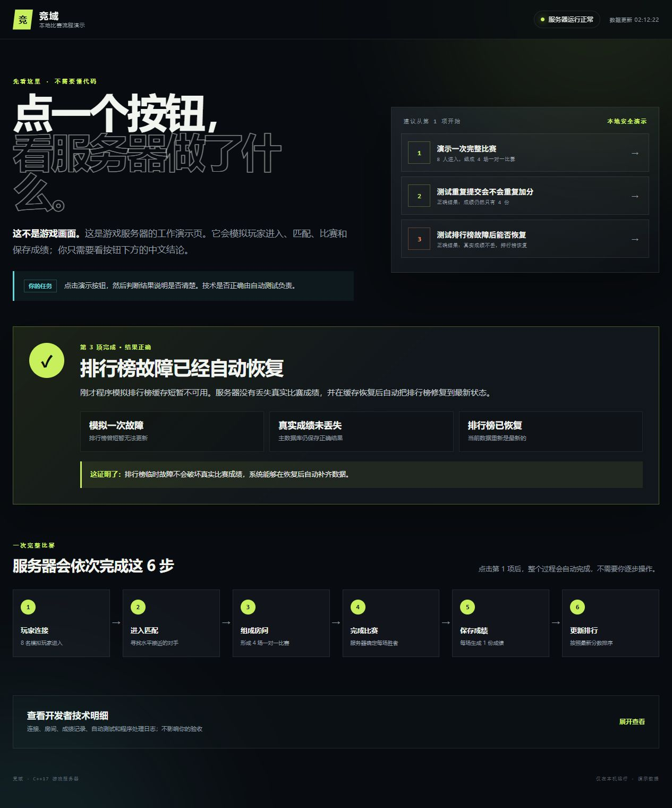
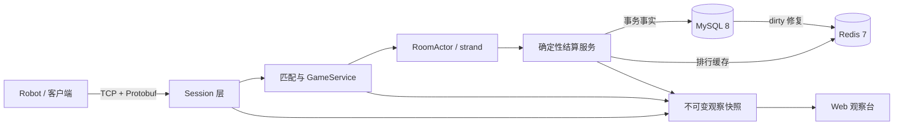

# 竞域 · arena-core-server

一个可在 WSL2 Ubuntu 复现的 C++17 联机服务端简历项目。它不制作游戏画面，而是把服务端真正困难的部分放进一条可验证链路：

`TCP/Protobuf 会话 → 心跳与重连 → 1v1 匹配 → 房间准备 → 服务端确定结果 → MySQL 事务结算 → Redis 排行 → Web 观察台`

当前版本：`1.0.0`。M0—M8 的实现、双编译器回归、隔离 clean-copy、Compose 重启与真实业务 smoke 均已完成；公开 GitHub 只是可选的外部发布动作。



## 60 秒看懂项目

- 这不是游戏客户端：浏览器页面是“服务端观察台”，用来解释玩家连接、比赛房间、成绩保存、重复提交保护和缓存故障恢复。
- 业务结果由服务端冻结，客户端没有“我赢了”的提交入口；相同比赛重复提交只返回原收据，不会重复加分。
- MySQL 是结算事实源，Redis 是可修复的排行榜缓存；缓存失败会保留 dirty 证据并从 MySQL 重放。
- 网络/房间对象由 Asio 执行器和 strand 串行拥有，阻塞存储进入有界线程池，避免共享容器被任意线程修改。
- Robot 能真实连接协议端口，完成匹配、入房、准备、结算、查榜，并在服务重启后重放同一场景核对业务结果。

## 架构



更完整的模块、线程所有权和失败路径见 [架构说明](docs/architecture.md)。

## 最快演示：Docker Compose

前置条件：WSL2 Ubuntu、Git、Docker Desktop/Engine 与 Docker Compose v2。Docker Desktop 用户要为当前 WSL 发行版开启 WSL Integration。

```bash
git clone <repository-url> arena-core-server
cd arena-core-server
./scripts/doctor.sh
./scripts/demo-up.sh
```

`demo-up.sh` 会生成被 Git 忽略的 `.runtime/` 配置，构建 C++ 镜像，等待 MySQL/Redis 健康，幂等执行迁移，再运行一次真实 Robot smoke。成功后打开：

- 观察台：<http://127.0.0.1:49120/>
- TCP：`127.0.0.1:49110`
- 机器可读结果：`.runtime/smoke-report.json`

再次验证或停止：

```bash
./scripts/smoke.sh
./scripts/demo-down.sh
```

普通停止保留 MySQL/Redis 演示卷。只有明确需要清空演示数据时才运行：

```bash
./scripts/demo-down.sh --reset
```

该命令只删除 Compose 项目 `arena-core-demo` 的演示卷，不删除源码。

## 原生 C++ 构建

主验证环境为 Ubuntu 24.04 / WSL2。安装系统依赖：

```bash
sudo apt-get update
sudo apt-get install -y \
  cmake ninja-build g++ clang \
  libboost-system-dev libboost-thread-dev \
  libprotobuf-dev protobuf-compiler \
  libspdlog-dev nlohmann-json3-dev libgtest-dev \
  libmysqlcppconn-dev libhiredis-dev liblua5.4-dev pkg-config
```

构建与测试：

```bash
./scripts/doctor.sh --native
cmake --preset linux-gcc
cmake --build --preset linux-gcc
ctest --preset linux-gcc

cmake --preset linux-clang
cmake --build --preset linux-clang
ctest --preset linux-clang
```

普通 CTest 会明确跳过需要真实 MySQL/Redis 环境变量的那一个集成入口；真实依赖验证由隔离脚本执行：

```bash
./scripts/dev/m5-data-integration.sh out/build/linux-gcc
```

## 测试证据

| 证据 | 实测结果 |
|---|---|
| GCC / Clang 普通回归 | 各 80/80，含 1 个按设计跳过的真实依赖入口；隔离脚本另行实际执行 |
| 真实 MySQL / Redis | 两套编译器各 12/12，完整 Robot 数据链通过 |
| Clang ASan + UBSan | 80/80，并通过 M7 E2E |
| GCC TSan 目标集 | 50/50；Boost.Asio fence 工具链限制有明确记录 |
| 重启重放 / 8 人 / 停机 | 通过；E2E 最慢退出 105 ms |
| 稳定性 | 500 连接、250 房间、600 秒、299500 心跳、业务错误 0 |
| 资源与延迟 | 服务峰值 RSS 22.5 MiB；完整业务闭环 P99 370.716 ms |

稳定性数字来自本机 WSL2 参考环境，不代表极限吞吐，也不是公网 RTT。原始口径和限制见 [M7 稳定性报告](docs/quality/M7-stability-report-2026-08-12.md)，所有需求与证据映射见 [测试矩阵](docs/quality/requirements-test-matrix.md)。

常用回归入口：

```bash
./scripts/dev/m3-smoke.sh out/build/linux-gcc
./scripts/dev/m6-observer-smoke.sh out/build/linux-gcc
./scripts/dev/m7-e2e.sh out/build/linux-gcc
./scripts/dev/m7-soak.sh out/build/linux-gcc scenarios/qa/preflight-500-connections.json
```

## 文档入口

- [架构与线程边界](docs/architecture.md)
- [协议与业务链路](docs/protocol-and-flow.md)
- [数据一致性](docs/data-consistency.md)
- [测试策略](docs/testing.md)
- [真实故障复盘](docs/incident-reviews.md)
- [已知限制](docs/known-limitations.md)
- [运维与排障](docs/operations/runbook.md)
- [v1.0.0 发布说明](docs/release-notes-v1.0.0.md)

规格基线仍保存在 `docs/specs/`，关键架构决定保存在 `docs/adr/`。

## 安全与边界

- Compose 只把 TCP/观察台发布到宿主机 `127.0.0.1`，MySQL/Redis 不发布宿主机端口。
- 配置只保存环境变量名称，不保存真实凭证；演示默认密码仅用于本机隔离网络，公开部署前必须更换。
- v1 不包含图形客户端、战斗玩法、账号/支付、微服务、Kubernetes、云部署、高可用或商业上线承诺。
- 当前不应把项目描述成“生产级在线游戏平台”；它是可复现、可解释、有真实测试证据的单机模块化服务端工程。

## 版本与许可

本地仓库以 `v1.0.0` 作为完成基线，并采用 [MIT License](LICENSE)。源码尚未上传到公开 GitHub，也没有替项目所有者创建远端 Release；公开发布时可以直接推送本地 `main` 与 `v1.0.0` 标签，不需要改动项目内容。
