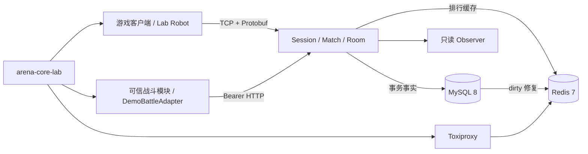

# 竞域 · arena-core-server

[](https://github.com/jingjie2002/arena-core-server/actions/workflows/ci.yml)

竞域是一个基于 C++17 的 1v1 竞技游戏对局编排、结算与排行服务端。它向游戏客户端提供会话、匹配与房间协议，并通过独立的可信结果接口接收战斗模块产生的权威结果。

项目聚焦战斗之外的后台链路：

`TCP/Protobuf 会话 → 心跳与断线恢复 → 1v1 匹配 → 房间准备 → 可信战斗结果 → MySQL 事务结算 → Redis 排行与自动修复 → 玩家结果通知`

当前版本：`1.1.0`。

## 核心能力

- 玩家通过长度帧 + Protobuf 完成 Hello、心跳、业务请求和短时断线恢复。
- 恢复连接后轮换 Session 凭证，并通过 generation 阻止旧连接影响新连接。
- 匹配服务生成 ticket、match、room 和一次性 Join Token。
- RoomActor 由 Boost.Asio strand 串行拥有，避免并发修改房间状态。
- 双方 Ready 后进入 `AwaitingResult`，普通玩家不能自行声明胜负。
- 可信战斗模块通过独立 Bearer HTTP 接口提交权威结果。
- 同一结果重复提交返回原 receipt，不重复结算；冲突结果会被拒绝。
- MySQL 保存唯一结算事实，Redis 作为可修复的排行缓存。
- Redis 更新失败时保留 dirty 记录，恢复后从 MySQL 自动修复。
- 玩家可以接收结算推送，也可以按 match 查询已持久化结果。
- Robot 与 Scenario Lab 均通过真实 TCP 和可信结果 HTTP 边界执行测试。

## 技术栈

| 类别 | 技术 |
|---|---|
| 语言与构建 | C++17、CMake、Ninja |
| 网络与并发 | Boost.Asio、Boost.Beast、strand、线程池 |
| 通信协议 | Protobuf、4 字节大端长度帧 |
| 数据存储 | MySQL 8、Redis 7、Lua |
| 测试 | GoogleTest、CTest、Robot E2E、ASan、UBSan、TSan |
| 本地运行 | Docker Compose、HAProxy、Toxiproxy |
| 管理界面 | 原生 HTML、CSS、JavaScript |

## 系统架构



核心服务采用模块化单体结构：

- `arena-core-server`：玩家连接、Session、匹配、Room、可信结果、结算和观察接口。
- `arena-core-robot`：通过真实协议执行端到端流程和稳定性测试。
- `arena-core-lab`：本机 QA 场景控制器，只在 `lab` profile 中启动。
- Observer：只读展示 Session、匹配、房间、结算、排行和事件。
- Scenario Lab：允许修改受控业务参数、运行场景、查看断言和重放结果。

更完整的线程、网络与故障边界见[架构说明](docs/architecture.md)。

## Observer 与 Scenario Lab

| 页面 | 作用 | 是否修改服务状态 |
|---|---|---|
| Observer | 查看在线会话、匹配、房间、结算、排行缓存和事件 | 否，只读 |
| Scenario Lab | 选择场景、调整安全参数、运行真实协议链、查看断言和重放 | 是，仅限本机 Lab profile |

Scenario Lab 不能提交 host、port、token、SQL、Shell 或文件路径，只接受服务端 Schema 允许的业务参数。


## 内置测试场景

Scenario Lab 提供五类真实场景：

1. **完整对局**：调整玩家数、MMR、连接间隔和 Ready 延迟。
2. **断线恢复**：选择断线玩家、断线阶段以及恢复窗口内外的延迟。
3. **重复玩家请求**：原样重发同一个 `request_id` 和载荷，验证副作用只发生一次。
4. **重复可信结果**：验证相同结果的幂等语义和冲突结果拒绝。
5. **Redis 故障恢复**：通过 Toxiproxy 模拟断开、延迟、超时或连接重置，验证 MySQL 事实和排行修复。

每次运行都会生成独立 `run_id`，并保存：

- 最终参数、随机种子、版本和配置摘要；
- 按顺序发生的真实事件；
- 预期值、实际值和自动断言；
- match、room、result 和缓存状态等业务证据；
- 失败、取消、超时原因和清理结果。

重放会创建新的 `run_id`，复用原场景、参数、seed 和 timeout，并通过语义断言比较业务结果。

## 快速开始

前置条件：

- WSL2 Ubuntu 或 Ubuntu 24.04；
- Git；
- Docker Desktop / Docker Engine；
- Docker Compose v2。

Docker Desktop 用户需要为当前 WSL 发行版开启 WSL Integration。

### 默认模式

```bash
git clone https://github.com/jingjie2002/arena-core-server.git
cd arena-core-server
./scripts/doctor.sh
./scripts/demo-up.sh
```

启动成功后：

- Observer：<http://127.0.0.1:49120/>
- 玩家 TCP：`127.0.0.1:49110`
- smoke 报告：`.runtime/smoke-report.json`

### Lab 模式

```bash
./scripts/demo-down.sh
./scripts/demo-up.sh --lab
```

启动成功后：

- Scenario Lab：<http://127.0.0.1:49140/>
- Observer：<http://127.0.0.1:49120/>
- Run 报告：`.runtime/lab-runs/<run_id>.json`

### 停止服务

```bash
./scripts/demo-down.sh          # 默认模式，保留数据
./scripts/demo-down.sh --lab    # Lab 模式，清除故障注入后停止
./scripts/demo-down.sh --reset  # 清空当前 Compose 项目的演示数据卷
```

`--reset` 只删除当前 Compose 项目的 MySQL/Redis 数据卷，不删除源码。MySQL、Redis、Toxiproxy 控制口和可信结果端口不会发布到宿主机。

## 原生构建

```bash
sudo apt-get update
sudo apt-get install -y \
  cmake ninja-build g++ clang \
  libboost-system-dev libboost-thread-dev \
  libprotobuf-dev protobuf-compiler \
  libspdlog-dev nlohmann-json3-dev libgtest-dev \
  libmysqlcppconn-dev libhiredis-dev liblua5.4-dev pkg-config

./scripts/doctor.sh --native

cmake --preset linux-gcc
cmake --build --preset linux-gcc
ctest --preset linux-gcc

cmake --preset linux-clang
cmake --build --preset linux-clang
ctest --preset linux-clang
```

真实依赖和端到端测试：

```bash
./scripts/dev/m5-data-integration.sh out/build/linux-gcc
./scripts/dev/m9-e2e.sh out/build/linux-gcc
./scripts/lab-smoke.sh
```

普通 CTest 会按设计跳过需要真实依赖环境变量的 DataIntegration 入口。

## 验证状态

当前版本的主要验证结果：

- GCC 与 Clang 全量测试各 `119/119`；
- 真实 MySQL/Redis 数据集成 `12/12`；
- ASan + UBSan 全量测试 `119/119`；
- TSan 并发测试 `103/103`；
- 500 个连接、250 个房间持续运行 600 秒，业务错误为 `0`；
- 从精确提交重新克隆后，原生构建、默认 Compose 和 Lab Compose 均通过；
- 桌面端与 390 px 移动端页面无控制台错误和横向溢出。

详细命令和结果见[完整验证记录](docs/operations/M12-final-verification-2026-08-17.md)。

## 接入方式

游戏客户端接入玩家 TCP 协议，负责：

- Hello 与心跳；
- 创建、取消和等待匹配；
- Join、Ready 和断线恢复；
- 接收比赛结果；
- 查询已提交结果和排行。

可信战斗模块接入 `/internal/v1/match-results`，在战斗结束后提交：

- 唯一 `result_id`；
- match、room 与参赛玩家；
- 胜负结果；
- 规则版本；
- 战斗结束时间。

具体顺序、错误语义和示例见[接入指南](docs/integration-guide.md)与[协议流程](docs/protocol-and-flow.md)。

## 安全边界

- Observer 默认只读。
- Lab 只用于本机或受控私有网络，不提供公网账号系统、TLS 或 RBAC。
- 配置文件只保存环境变量名称，不保存真实 token。
- 示例密码仅用于隔离的本机 Compose 环境。
- 普通玩家没有可信比赛结果写权限。
- 浏览器不能直接修改数据库、Redis、服务端内存或运行任意命令。

## 项目范围

本项目不包含：

- 战斗同步、角色移动、技能、AOI 或图形客户端；
- 账号、支付、聊天、公会或反作弊系统；
- 多进程分片、跨机房容灾、Redis Cluster 或 Kubernetes；
- 可直接部署到公网的生产级认证与高可用方案。

项目定位是一个可接入、可观测、可重放并支持故障验证的竞技游戏对局与结算服务端模块。

## 文档

- [架构与线程边界](docs/architecture.md)
- [协议与业务流程](docs/protocol-and-flow.md)
- [客户端与战斗模块接入](docs/integration-guide.md)
- [数据一致性](docs/data-consistency.md)
- [测试策略](docs/testing.md)
- [运维与排障](docs/operations/runbook.md)
- [已知限制](docs/known-limitations.md)
- [v1.1.0 版本说明](docs/release-notes-v1.1.0.md)
- [完整验证记录](docs/operations/M12-final-verification-2026-08-17.md)
- [需求—测试矩阵](docs/quality/requirements-test-matrix.md)

## License

本项目采用 [MIT License](LICENSE)。
