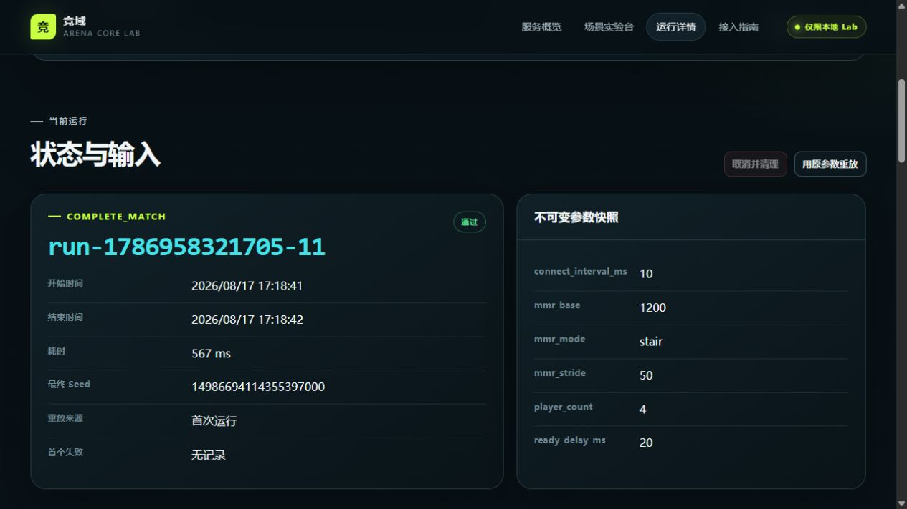
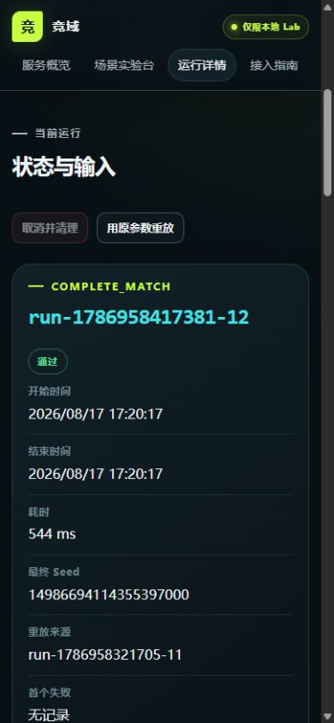
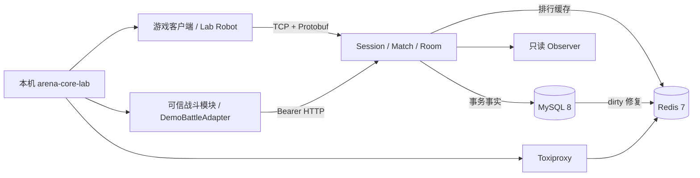

# 竞域 · arena-core-server

竞域是一个可接入客户端与可信战斗模块的 C++17 1v1 对局编排、结算与排行服务端，也是一个可在 WSL2 / Ubuntu 24.04 独立复现的游戏服务端工程样例。

它不实现游戏画面、角色移动或技能战斗，而是完成战斗之外最容易出错的一条后台链路：

`TCP/Protobuf 会话 → 心跳/断线恢复 → 1v1 匹配 → 房间准备 → 可信战斗结果 → MySQL 事务结算 → Redis 排行/自动修复 → 玩家结果通知`

当前代码版本为 `1.1.0`，位于实验分支 `codex/v1.1-scenario-lab`。它仍是本地候选版本：没有合并 `main`、打标签或上传公开 GitHub。

## 先看懂两个网页

| 页面 | 作用 | 能否改变服务状态 |
|---|---|---|
| Observer 观察台 | 查看在线会话、匹配、房间、已保存成绩、排行缓存和事件 | 不能，只读 |
| Scenario Lab | 选择安全场景、修改参数、运行真实协议链、查看自动断言和重放 | 可以，但只在本机 Lab profile 内 |

Observer 不是游戏画面，也不再提供制造假数据的按钮。Lab 不是数据库管理后台：浏览器不能填写 host、port、token、SQL、Shell 或文件路径，只能提交服务端 Schema 明确允许的业务参数。

桌面与手机端的真实 Run 页面：





## 这个项目目前能做什么

- 玩家通过长度帧 + Protobuf 完成 Hello、心跳、业务请求和短时断线恢复；恢复后 Session 凭证轮换，旧 transport 失效。
- 匹配服务为两个玩家生成 ticket、match、room 和一次性 Join Token，RoomActor 由 Asio strand 串行拥有。
- 双方 Ready 后进入 `AwaitingResult`；普通玩家不能声明胜负，可信战斗模块通过独立 Bearer 接口提交结果。
- 同一结果重复提交返回原 receipt，不重复加分；相同 ID 的冲突结果被拒绝。
- MySQL 保存唯一结算事实；Redis 只作为可修复排行缓存。缓存失败时保留 dirty 记录，恢复后从 MySQL 补齐。
- 玩家会收到已提交结果推送，也能按 match 查询自己的持久结果。
- Robot 和 Lab 都走真实 TCP 与可信结果 HTTP 边界，不直接调用 GameService、Room 或数据库伪造成功。

## 最快运行

前置条件：WSL2 Ubuntu、Git、Docker Desktop/Engine、Docker Compose v2。Docker Desktop 用户需要为当前 WSL 发行版开启 WSL Integration。

### 只读观察模式

```bash
git clone <repository-url> arena-core-server
cd arena-core-server
./scripts/doctor.sh
./scripts/demo-up.sh
```

成功后打开：

- Observer：<http://127.0.0.1:49120/>
- 玩家 TCP：`127.0.0.1:49110`
- smoke 报告：`.runtime/smoke-report.json`

### 可变参数 Lab 模式

```bash
./scripts/demo-down.sh
./scripts/demo-up.sh --lab
```

成功后打开：

- Scenario Lab：<http://127.0.0.1:49140/>
- Observer：<http://127.0.0.1:49120/>
- 每次 Run 报告：`.runtime/lab-runs/<run_id>.json`

Lab 提供五类真实 P0 场景：

1. 完整对局：调整玩家数、MMR、连接间隔和 Ready 延迟。
2. 断线恢复：选择玩家、断线阶段和恢复窗口内/外延迟。
3. 重复玩家请求：原样重发同一 `request_id` 与载荷，检查副作用只有一次。
4. 重复可信结果：检查完全相同结果的幂等语义和冲突结果拒绝。
5. Redis 故障恢复：通过 Toxiproxy 让真实 Redis 链路断开、延迟、超时或重置，再检查 MySQL 事实与排行修复。

停止服务：

```bash
./scripts/demo-down.sh          # 默认模式，保留数据
./scripts/demo-down.sh --lab    # Lab 模式，先清除故障再停止
./scripts/demo-down.sh --reset  # 明确清空本项目 Compose 数据卷
```

`--reset` 只删除当前 Compose 项目的 MySQL/Redis 演示卷，不删除源码。Lab/Toxiproxy、MySQL、Redis 和可信结果端口都不会发布到宿主机；宿主机只暴露 loopback 的 TCP、Observer 和 Lab 页面。

## Lab 中一次 Run 是什么

每次点击“创建并运行”都会生成一个独立 `run_id`，状态依次经过校验、启动、运行、验证、清理和终态。报告保存：

- 最终参数、随机种子、版本、commit 与服务配置摘要；
- 按顺序发生的真实事件；
- 预期值、实际值和自动断言；
- match、room、result、缓存状态等业务证据；
- 首个失败、取消/超时原因和清理结果。

报告不会保存 Session token、可信结果 Bearer token 或数据库密码。“重放”会创建新的 `run_id`，但复用原场景、参数、seed 与 timeout，并通过语义断言比较结果，不比较每次都会变化的动态 ID。

## 架构



核心服务是 C++17 模块化单体；`arena-core-lab` 是单独进程，只在 `lab` profile 启动。更完整的线程、网络和故障边界见 [架构说明](docs/architecture.md)。

## 原生构建与测试

```bash
sudo apt-get update
sudo apt-get install -y \
  cmake ninja-build g++ clang \
  libboost-system-dev libboost-thread-dev \
  libprotobuf-dev protobuf-compiler \
  libspdlog-dev nlohmann-json3-dev libgtest-dev \
  libmysqlcppconn-dev libhiredis-dev liblua5.4-dev pkg-config

./scripts/doctor.sh --native
cmake --preset linux-gcc
cmake --build --preset linux-gcc
ctest --preset linux-gcc

cmake --preset linux-clang
cmake --build --preset linux-clang
ctest --preset linux-clang
```

普通 CTest 会按设计跳过需要真实依赖环境变量的 DataIntegration 入口。真实依赖、可信结果和 Compose Lab 分别由以下脚本执行：

```bash
./scripts/dev/m5-data-integration.sh out/build/linux-gcc
./scripts/dev/m9-e2e.sh out/build/linux-gcc
./scripts/lab-smoke.sh
```

测试数由 CTest 动态发现，不在 README 硬编码。v1.0 的 500 连接 / 250 房间 / 600 秒稳定性结果仍是历史性能基线；v1.1 的最终回归、Sanitizer、真实依赖、五场景 Lab 与 fresh-clone 证据以 [M12 验证记录](docs/operations/M12-final-verification-2026-08-17.md) 为准，未执行的门禁必须在该记录中明确标注，不能用历史数字代替。

## 如何接入自己的游戏

最小接入分成两端：

- 游戏客户端接入玩家 TCP 协议，负责 Hello、匹配、Join、Ready、接收结果和查询排行。
- 受信任的战斗服接入 `/internal/v1/match-results`，在战斗结束后提交唯一 `result_id`、match/room、胜负方、规则版本和结束时间。

具体请求顺序、错误语义和示例见 [接入指南](docs/integration-guide.md) 与 [协议流程](docs/protocol-and-flow.md)。

## 安全与明确不做的事

- 默认 Observer 只读；旧版 Demo 写接口在公开 Compose 路径中关闭。
- Lab 只设计为本机/受控私有网络工具，没有 TLS、账号系统、RBAC 或多人远程使用能力。
- 配置文件只保存环境变量名称，不保存真实 token；示例密码只适用于本机隔离 Compose。
- 不包含战斗同步、AOI、图形客户端、账号/支付/聊天/公会/反作弊。
- 不包含多进程分片、跨机房容灾、Redis Cluster、Kubernetes 或生产高可用承诺。
- 不能把当前项目描述成完整游戏或可直接公网运营的平台；准确定位是“可接入、可解释、可故障验证的竞技游戏对局与结算服务端模块”。

## 文档入口

- [架构与线程/网络边界](docs/architecture.md)
- [协议与业务链路](docs/protocol-and-flow.md)
- [接入指南](docs/integration-guide.md)
- [数据一致性](docs/data-consistency.md)
- [测试策略](docs/testing.md)
- [运维与排障](docs/operations/runbook.md)
- [已知限制](docs/known-limitations.md)
- [v1.1.0 说明](docs/release-notes-v1.1.0.md)
- [v1.1 最终验证记录](docs/operations/M12-final-verification-2026-08-17.md)
- [v1.1 非技术交接](docs/handoffs/M12-v1.1-scenario-lab.md)
- [需求—测试矩阵](docs/quality/requirements-test-matrix.md)

## 许可与发布边界

项目采用 [MIT License](LICENSE)。本地 `main` 与历史 `v1.0.0` / `v1.0.1` 基线保持不动；是否合并 v1.1 实验分支、创建标签或上传 GitHub，由项目所有者在最终可见性验收后决定。
