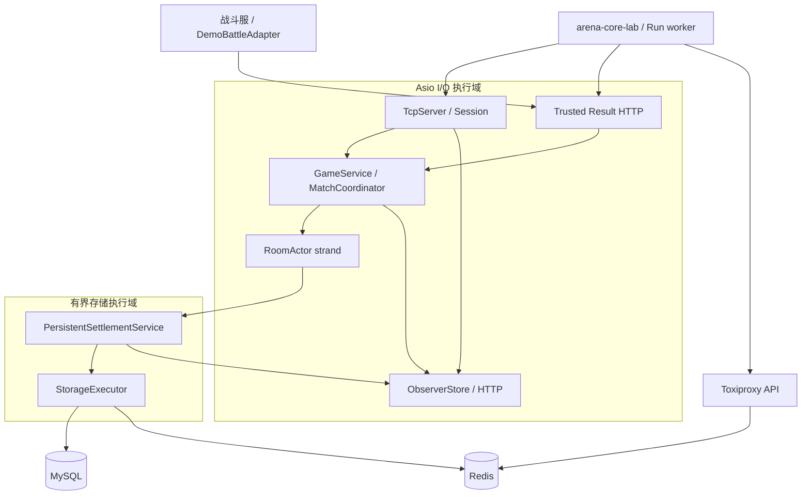
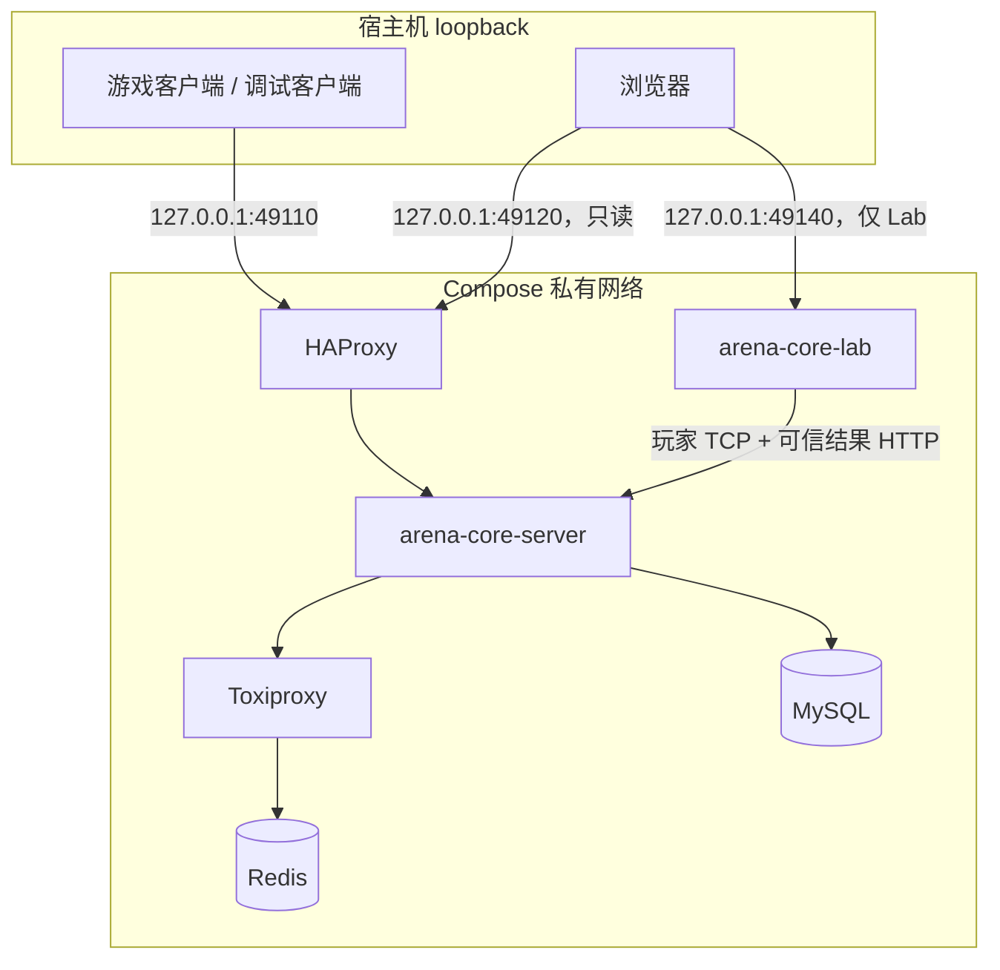

# 架构与线程边界

## 总体结构

竞域的正式业务核心是一个 C++17 模块化单体。单进程承载玩家 TCP 会话、匹配、房间、可信比赛结果入口、结算与观察层，MySQL/Redis 是外部数据依赖。可变场景实验台 `arena-core-lab` 是单独进程，只在本机 Lab profile 启动；它通过公开协议边界驱动核心服务，不链接后门业务接口。

## 模块职责

| 模块 | 职责 | 不允许承担 |
|---|---|---|
| `protocol` | 4 字节大端长度帧、Protobuf Envelope、指纹 | 业务状态变化 |
| `session` | Hello、token、心跳、重连、发送队列、关闭 | 匹配/结算规则 |
| `game` | 排队、撮合、Join Token、RoomActor、可信结果校验与独立 HTTP listener | 直接阻塞数据库或让玩家写入胜负 |
| `rules` | 受限 Lua 规则加载、版本与确定性检查 | 文件/网络/系统能力 |
| `settlement/storage/rank` | MySQL 事务、幂等、Redis 排行、dirty 修复 | 客户端权威结果 |
| `observer` | 读取不可变快照、有限事件日志、本地 HTTP | 跨线程遍历可变业务容器 |
| `qa` | Robot/Lab 协议客户端、Scenario Schema、Run、DemoBattleAdapter、报告和 Toxiproxy 控制 | 接受任意网络/凭证参数、修改服务端内部对象或绕过可信结果入口 |

## 正式服务与 Lab 的边界

- 默认 profile 不启动 Lab 或 Toxiproxy，Observer 的 Demo 写模式关闭。
- Lab profile 才让可信结果 listener 在 Compose 私有网络监听；`9200` 不发布到宿主机。
- MySQL `3306`、Redis `6379`、Toxiproxy 控制口 `8474` 和代理口 `26379` 都不发布到宿主机。
- Lab HTTP 虽在容器内监听 `0.0.0.0:8081`，宿主机发布仍固定为 `127.0.0.1`。该私网例外必须显式配置。
- 浏览器与 Lab API 同源，CSP 的 `connect-src 'self'` 不需要放宽。

## Lab Run 所有权

- HTTP 层只负责 Schema、创建/查询/重放/取消；同一 Lab 只允许一个活动 Run。
- 每个 Run 由独立 C++ worker 持有场景客户端、deadline 与取消信号；所有同步 facade 底层都是带截止时间的 Asio 操作。
- Run 进入终态前一定经过 Cleaning。Toxiproxy 使用 RAII reset guard，失败、超时、取消和进程停止都会尽力恢复代理。
- 活动 Run 在报告持久化完成前保持 `Cleaning`，避免页面先看到 Passed、下一次创建却仍被“已有活动 Run”拒绝。
- Run 文件采用临时文件 + rename 保存，不记录 Session/恢复凭证、Bearer token 或数据库密码。

## 线程所有权

- `io_context` 承载玩家 accept、可信结果 HTTP、Session、GameService、Room 和 Observer 回调；RoomActor 的命令由 strand 串行执行。
- Session 只经 `BusinessService` 提交业务命令；GameService 只经 notifier 推送协议事件，网络层与领域层不直接互相操作容器。
- MySQL/Redis 的阻塞调用进入容量受限的 `StorageExecutor`。队列满时明确失败，不无限堆积。
- ObserverStore 在写入时复制/规整展示数据，HTTP 请求读取不可变 JSON 快照；慢消费者通过事件序号缺口识别丢失。
- Lab HTTP 可由多个 Asio 线程处理短请求；业务场景仍由单活动 worker 串行拥有，不共享协议客户端。
- 停机顺序是停止接入、停止观察入口、排空 I/O 和房间、停止存储执行器，Stop 可重复调用。

## 关键取舍

- 模块化单体优先于微服务：v1 的目标是可复现闭环和线程/一致性证据，而不是部署拓扑复杂度。
- 回调/strand 优先于 C++20 协程：语言标准锁定 C++17，并由编译契约测试阻止误升 C++20。
- MySQL 是事实源，Redis 是缓存：允许缓存短时过期，但不允许“Redis 成功、MySQL 未提交”的半结算。
- 系统包薄适配器优先于 configure 时临时下载第三方包装库：降低 fresh-clone 网络漂移。

详细决定见 `docs/adr/0001`—`0005`，线程契约见 `docs/specs/thread-ownership-v1.md`。
