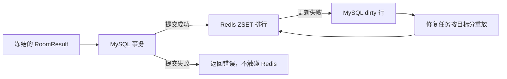

# 数据一致性

## 写入顺序

MySQL 事务先锁定双方玩家行，再写 match、settlement、match_players、玩家分数和排行榜目标分 dirty 记录。事务提交成功后才更新 Redis；Redis 成功后清理 dirty。这样可能短时看到旧排行，但不会丢失真实比赛成绩。

## 幂等与冲突

- `settlements.match_id` 唯一，`settlement_id` 是主键。
- 已存在 match_id 且 fingerprint 相同：返回第一次提交的收据，分数不再次变化。
- 已存在 match_id 但 fingerprint 不同：返回稳定冲突，数据库与排行不产生第二次写入。
- MySQL 失败：整个事务回滚，Redis 不更新。
- Redis 失败：MySQL 事实保留，`rank_cache_dirty` 记录目标分、次数、错误与下次重试时间。

## 排行

Redis 使用 ZSET；分数相同按 player_id 稳定排序，查询支持本人名次和相邻玩家。修复既支持单条重放，也支持从 MySQL 全量重建。

## Compose 迁移

`migrations/001_m5_settlement.sql` 使用 `CREATE TABLE IF NOT EXISTS` 和 `INSERT IGNORE schema_migrations`。Compose 的一次性 `migrate` 服务每次启动都会执行该文件，重复执行不破坏已有数据。普通 `demo-down.sh` 保留卷；显式 `--reset` 才删除演示卷。

数据库字段与索引见 `docs/specs/data-model-v1.md` 和迁移文件。

## Lab 中的真实 Redis 故障

Lab profile 让核心服务把 Redis 地址指向 `toxiproxy:26379`，而不是直接连接 `redis:6379`。场景开始前重置代理，再按白名单注入断开、延迟、超时或 reset-peer；控制 API `8474` 与代理端口都只存在于 Compose 私有网络。

Redis 故障 Run 必须依次留下三阶段证据：

1. 可信结果 HTTP 返回 MySQL 已提交的 receipt，同时 `cache_state=stale`；
2. 按 result_id 查询仍能从 MySQL 找到相同结算事实和 dirty 状态；
3. reset Toxiproxy 后轮询玩家排行，直到两人都为 `fresh`，再次查询 receipt 确认 dirty 已清理且分数与排行一致。

RAII reset guard 覆盖成功、断言失败、取消和超时路径；`scripts/demo-down.sh --lab` 与 `scripts/lab-smoke.sh` 也会在退出时再次复位，避免一次故障影响下一次 Run。
