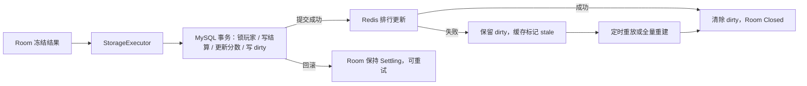

# M5 交接：数据一致性与 Lua 规则

- 日期：2026-08-12
- 结论：Room 的冻结结果现在会先进入 MySQL 事实事务，提交后再更新 Redis 排行；缓存失败可通过 dirty 记录修复，不会污染事实数据。

## 已解决什么

- 结算以 `match_id + result_fingerprint` 幂等：相同指纹重放返回原结果，不同指纹稳定报冲突。
- 单个事务锁定双方玩家并写入比赛、结算、参赛分数和排行榜 dirty；任一步失败都会整体回滚。
- Redis 排行使用 score 降序、player id 升序的稳定并列规则，支持邻近查询。
- Redis 更新失败不会回滚已提交的 MySQL；dirty 会保留并在依赖恢复后重放，必要时从事实表全量重建。
- Room 在持久化失败时保持 `Settling`，重试成功后才 `Closed`。
- Lua 计分/匹配规则有显式版本、确定性输入、能力隔离和指令预算；无限循环脚本会被中止。



## 五个关键文件

1. `migrations/001_m5_settlement.sql`：M5 数据模型、约束、索引和 dirty 表。
2. `src/storage/mysql_settlement_repository.cpp`：MySQL 事务、幂等、锁定、回滚和修复查询。
3. `src/settlement/persistent_settlement_service.cpp`：异步结算、缓存状态、重试和重建编排。
4. `src/rank/rank_cache.cpp`：内存/Redis 排行与连接池。
5. `src/rules/rule_engine.cpp`：内建/Lua 规则、版本验证、能力隔离和指令预算。

## 最短验证入口

在 WSL 项目根目录执行：

```bash
./scripts/dev/m5-data-integration.sh out/build/linux-gcc
```

它会使用隔离端口启动临时 MySQL/Redis、建库迁移、运行 `data` 标签测试、启动真实服务端、验证停止与查询计划，最后清理临时实例。Clang 将路径改为 `out/build/linux-clang`。

正常时应看到 `100% tests passed`、`DataIntegration` 实际执行，以及两条 EXPLAIN 分别命中 `match_id` 与 `idx_rank_dirty_retry`。故障用例中 Redis 会被主动断开；预期现象是 MySQL 已提交、dirty 仍存在、缓存状态为 stale，恢复后 dirty 清零且排行一致。

## 可做的小修改

- 把 `rules/score_rule.lua` 中胜者分数变化调小，重新运行 `RuleEngineTest`，观察 golden 期望失败；同步修改测试期望后应恢复通过。
- 不要直接删除版本字段：版本不匹配必须启动失败，这是防止旧规则静默改变线上结算的契约。

## 本轮真实问题复盘

最初 dirty 修复集成测试发现新记录无法立即被扫描。原因是 `rank_cache_dirty.next_retry_at` 为 `TIMESTAMP`，但查询使用 `UTC_TIMESTAMP()`；在 `+08:00` 会话中比较发生八小时错位。修复为同一会话语义下的 `CURRENT_TIMESTAMP(6)` 后，真实 Redis 故障—恢复用例通过。复现时可把查询临时改回 `UTC_TIMESTAMP()`，在非 UTC 会话下观察 dirty 暂时不可见。

## 当前边界

- M5 只持久化结算和排行榜；观察台、事件快照和可点击失败场景属于 M6。
- M7 还会补 Sanitizer、长时间压力、更多故障注入与各状态停机截止。
- M8 才提供 Docker/Compose 与 fresh-clone 发布验收；当前集成脚本依赖 WSL 已安装的系统包。
- 为兼容 Ubuntu 系统包和后续 fresh-clone，采用 MySQL Connector/C++、hiredis 和 Lua C API 薄适配器，取舍记录在 `docs/adr/0004-system-data-client-adapters.md`。

## 环境操作记录

- 本轮在 WSL 安装：MySQL Server 8.0.46、`libmysqlcppconn-dev` 1.1.12、`libhiredis-dev` 1.2.0、`liblua5.4-dev` 5.4.6。
- 测试使用独立端口 MySQL `33307`、Redis `6392`，不接触已有 Redis `6379`；临时实例在脚本结束后清理。
- 系统包安装自动启用过 MySQL 默认服务；验证结束后已停止并禁用其自启动，避免长期占用 `3306`。

## 用户介入

不需要。下一阶段是 M6；只有观察台和 Demo 完整可用后，才请用户执行第二次计划内人工测试。
