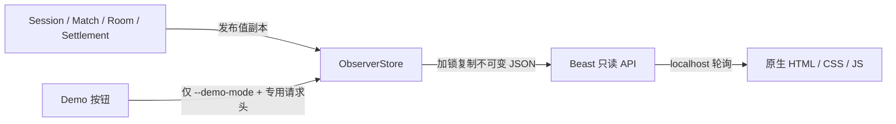

# M6 交接：观察台与可点击 Demo

- 日期：2026-08-12
- 结论：观察台已改为默认面向非技术用户的中文演示页；每次点击后会就地回答“刚才做了什么、结果是否正确、这证明了什么”。开发者证据仍保留，但默认折叠。

## 用户现在只需要做什么

打开 [http://127.0.0.1:39120/](http://127.0.0.1:39120/)；如果仍看到旧页面，刷新一次。然后：

1. 点击“1. 演示一次完整比赛”。
2. 只看按钮下方的大号结果卡，不需要向下寻找数据。
3. 如果愿意，再点击第 2、3 项；每项都会在同一位置直接显示中文结论。

预期能直接看到：

- 第 1 项：8 名玩家组成 4 场比赛，保存 4 份成绩。
- 第 2 项：重复提交被识别，成绩仍是 4 份，没有重复加分。
- 第 3 项：排行榜故障后自动恢复，真实成绩没有丢失。

“查看开发者技术明细”默认关闭，当前人工验收完全不需要展开。用户只需反馈一句“现在看得懂”或指出仍不清楚的那句话；C++、数据库、并发和内部编号继续由自动测试负责。

页面启动时不会预先运行任何场景，应先显示“等待开始”；这样每一张结果卡都只会在用户点击对应按钮后出现。

## 数据为什么安全



- 页面不持有业务对象指针，也不遍历其他 strand 的容器。
- 普通运行只有 GET 只读接口；POST Demo 同时需要 loopback、`--demo-mode` 和专用请求头。
- 事件日志有上限，慢消费者会收到 gap 标记，不会让内存无限增长。
- 静态文件只允许三个固定路径，并发送 CSP、no-sniff、禁止 frame 等响应头。

## 五个关键文件

1. `include/arena_core/observer/observer_store.hpp`：观察数据与线程边界。
2. `src/observer/observer_store.cpp`：快照、有限事件、QA Demo 数据。
3. `src/observer/http_server.cpp`：Beast API、静态文件和 Demo 安全门禁。
4. `web/observer/app.js`：中文状态映射、三种场景的就地结果判定、技术明细渲染与轮询。
5. `tests/observer/http_server_test.cpp`：只读、门禁、trace 顺序和新手讲解关键文案验证。

## 自动验证结论

- GCC/Clang 完整回归各 74/74。
- 观察层各 6/6；真实 HTTP smoke 两套均通过。
- 真实 TCP 双玩家闭环会把 Session、ticket、Closed Room、settlement、rank 与同 trace 事件写入 Observer；不是只编译了接口。
- M5 真实 MySQL/Redis 集成在 M6 生产启动改动后两套各 11/11 通过。
- 改版后浏览器实际点击三种场景均得到对应中文结论；技术明细默认折叠，浏览器错误日志为 0，1280px 视口无横向溢出。
- 旧版曾通过 390×844 真实响应式检查；本次改版保留并加强了 1000px/560px 断点，但当前浏览器工具的安全策略不允许创建新的窄屏容器，因此未把新版 390px 真实复测虚报为已完成。

## 演示边界

- 8 人/4 房间按钮是确定性的可视 Demo 场景，用来在 M6 展示信息组织；真实双玩家 TCP→结算→Observer 链路已有自动测试。
- M7 才会让 Robot 执行完整多玩家 E2E、故障重放、500 连接/250 房间/10 分钟参考场景与 Sanitizer。
- M8 才制作 Compose/fresh-clone 发布入口；当前服务使用已完成的 WSL 构建产物。

## 最短运行与停止

```bash
./scripts/dev/m6-demo.sh start out/build/linux-gcc
./scripts/dev/m6-demo.sh status
./scripts/dev/m6-demo.sh stop
```

当前已经由 Codex 启动，不需要用户执行命令。上述入口只用于以后复现。

## 可做的小修改

项目完成后的掌握度练习可以在 `web/observer/index.html` 增加一个字段或筛选项，再追踪它来自 ObserverStore 的哪个快照。当前人工验收不要求做这项练习。
