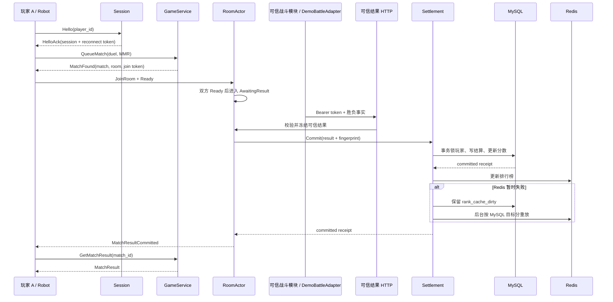

# 协议与业务链路

## 传输契约

- TCP 每帧为 `4 字节大端长度 + Protobuf Envelope`，有效载荷最大 65536 字节。
- Envelope 固定 `protocol_version=1`，携带消息类型、request_id、session_token 和具体 payload。
- 零长度、超长、畸形 Protobuf、未知版本和请求 ID 指纹冲突会被明确拒绝；致命协议错误关闭连接。
- 同一会话中相同 request_id + 相同指纹返回缓存响应；相同 request_id + 不同指纹视为冲突。

## 完整业务时序

## Session 与重连

- Hello 必须在截止时间前完成；心跳刷新空闲截止。
- 断线后 reconnect token 在 15 秒窗口内有效。成功恢复会同时轮换 session token、reconnect token 与 generation。
- 旧连接的迟到关闭不能撤销新 generation；窗口边界到期即拒绝恢复。
- Room 成员身份独立于具体 TCP 连接，合法重连不会丢失已加入房间的成员资格。

## 可信比赛结果边界

玩家协议没有“提交胜负”的消息。双方 Ready 后，RoomActor 停在 `AwaitingResult`；可信战斗模块使用独立 HTTP listener、Bearer service token 和明确网络边界提交胜负。本地 DemoBattleAdapter 也走同一入口，不绕过真实边界。

服务端校验 match、room、双方成员、规则版本和完成时间，再生成调用方不可指定的结果指纹。相同结果重放返回既有 receipt，不重复加分；result 或 match 内容冲突会被稳定拒绝。只有 MySQL 事务提交后，玩家才收到 `MatchResultCommitted`，断线后也可以只读查询。

完整边界与字段见 `docs/specs/m9-trusted-result-ingress.md`、`proto/arena_core.proto`、`docs/specs/protocol-v1.md` 和 `docs/specs/error-catalog-v1.md`。
