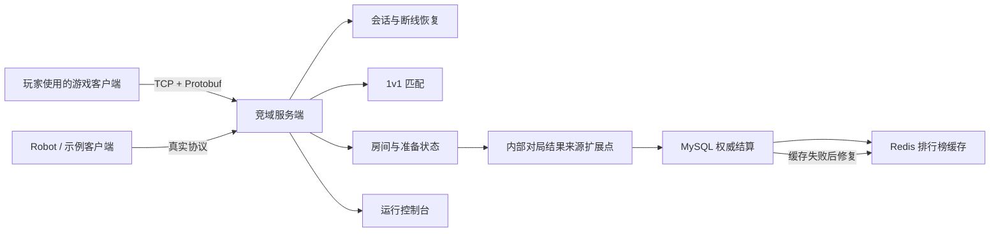
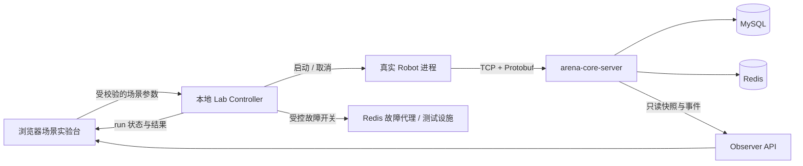

# 竞域项目定位与 v1.1 需求草案

> 状态说明：本文件保留为第一轮讨论记录。结合 GitHub 同类项目调研、可信结果接入边界和技术栈适配后的当前推荐方案，见 `docs/specs/v1.1-product-design-proposal.md`。

- 状态：设计草案，等待用户确认
- 日期：2026-08-12
- 适用阶段：v1.0.1 之后的展示与产品定位重构
- 当前限制：本文件确认前不修改业务代码，不上传 GitHub

## 1. 先说结论

推荐把项目正式定位为：

> **竞域｜C++17 1v1 竞技游戏对局编排与结算服务端**

一句话介绍：

> 竞域是一套面向小型 1v1 竞技游戏的 C++17 独立服务端参考实现，负责玩家会话、断线恢复、匹配、房间生命周期、对局结果结算和排行榜恢复，并通过真实机器人客户端与运行控制台证明完整链路。

它解决的是一场游戏“开始前、结束时和结束后”的后台问题，不实现游戏中的移动、技能和战斗。

## 2. 它在一款游戏中的位置

这里的“内部对局结果来源扩展点”代表未来可以接入战斗服或玩法模块。当前项目使用确定性结果源验证结算链路，但不声称已经实现战斗服务器。

## 3. 项目形态

项目不是可嵌入任意游戏的通用 C++ 库，也不是普通玩家直接使用的游戏产品。它由四个可以独立说明职责的部分组成：

1. `arena-core-server`：独立运行的 C++17 服务端程序。
2. `arena-core-robot`：通过真实 TCP/Protobuf 协议连接的示例客户端与 QA Runner。
3. Web 运行控制台：观察并启动真实演示场景，不承担玩家游戏界面职责。
4. MySQL、Redis 与 Docker Compose：提供事实存储、排行榜缓存和一键本地环境。

更准确的项目类型是“可运行的服务端参考工程”，不是“万能游戏服务端框架”。

## 4. 目标用户

### 4.1 运行时使用者

- 假想的 1v1 游戏客户端开发者：根据 Protobuf 协议接入连接、匹配、房间和排行。
- 服务端维护者：通过日志、健康状态和运行控制台定位会话、房间、结算及缓存问题。
- QA：通过 Robot 复现正常、重连、重复请求和依赖故障场景。

### 4.2 仓库阅读者

- C++ 游戏服务端岗位的面试官或技术评审。
- 想了解 C++17 异步网络、状态机、幂等和数据一致性的开发者。
- 项目所有者本人，用于学习、演示、修改和复测。

普通玩家不是这个仓库的直接使用者；他们需要另一个真正的游戏客户端。

## 5. 主要目标

### G1：实现一条真实的对局外围闭环

客户端能够连接、保持会话、排队、匹配、进入房间、准备；内部结果源结束对局后，服务端完成结算和排行更新。

### G2：保证网络异常不会轻易破坏玩家状态

覆盖心跳、超时、15 秒断线恢复、旧连接竞态和幂等关闭。

### G3：保证成绩不会重复、丢失或只保存一半

客户端不能自行提交胜负；MySQL 是事实源，相同结果重复提交不重复加分，Redis 故障不丢失结算并可以修复。

### G4：展示 C++ 游戏服务端工程能力

明确异步对象生命周期、strand 所有权、有界存储线程池、优雅停机、双编译器、Sanitizer、故障测试和稳定性证据。

### G5：让非作者能在 90 秒内看懂并运行真实链路

运行控制台不再只输出教学文字。每个可见操作必须实际经过 Robot、TCP/Protobuf、服务端状态机和相应数据依赖，并显示可核对的过程与结果。

## 6. v1.1 核心需求

### 6.1 会话与协议

- `SES-101`：客户端通过 TCP 长连接和 Protobuf Envelope 进入服务。
- `SES-102`：服务端管理 Hello、心跳、超时、重连凭证和重复请求。
- `SES-103`：页面能看到真实客户端连接、断开和恢复事件，不使用预填快照冒充。

### 6.2 匹配与房间

- `MAT-101`：只提供 `duel` 1v1 模式，按 MMR 与等待时间确定性配对。
- `MAT-102`：房间负责成员校验、加入凭证、双方 Ready 和状态推进。
- `MAT-103`：运行控制台能看到真实队列、配对、Room ID、双方状态和结束顺序。

### 6.3 结果、结算与排行

- `SET-101`：普通客户端协议没有提交胜负的入口；结果来自服务端内部扩展点。
- `SET-102`：MySQL 事务保存比赛、结算和双方目标分，不产生半状态。
- `SET-103`：相同指纹重复结算返回第一次结果，不重复加分；不同指纹返回冲突。
- `RNK-101`：Redis 提供排行读取；更新失败时保留 MySQL dirty 证据并自动修复。
- `RNK-102`：运行控制台能对比结算前后分数、数据库事实、缓存状态和修复过程。

### 6.4 真实演示与可观测性

- `DEM-101`：点击“运行完整对局”必须启动真实 Robot，通过 TCP 完成业务，禁止只向 ObserverStore 写入合成结果。
- `DEM-102`：至少提供正常对局、断线重连、重复结算保护、Redis 故障恢复四个真实场景。
- `DEM-103`：页面实时显示“客户端连接 → 匹配 → 房间 → 结算 → 排行”的状态变化，并能按一次运行的 trace 查看事件。
- `DEM-104`：场景结束必须给出机器可核对的结果：连接数、房间数、settlement ID、分数变化、排行状态和错误数。
- `DEM-105`：页面中的解释文字作为辅助帮助，不占据主要操作区，也不能替代真实数据。
- `DEM-106`：必须提供最小接入示例，说明第三方客户端怎样连接、发送什么、收到什么。

### 6.5 可操作测试实验台

- `LAB-101`：本机使用者可以选择场景并修改受支持的输入条件，不局限于三个固定按钮。
- `LAB-102`：每次运行保存不可变的参数快照、随机种子、开始/结束时间、构建版本和唯一 `run_id`，同一组输入可以重放。
- `LAB-103`：实验台只通过真实客户端协议和受控故障注入器影响系统，不能直接修改 Session、Room、结算表或 Observer 快照来伪造结果。
- `LAB-104`：输入必须有类型、范围、组合约束和运行超时；不允许页面执行任意命令、SQL、Lua、文件路径或网络地址。
- `LAB-105`：一次运行自动产生预期断言和实际结果，包括成功连接、完成房间、结算数量、业务错误和恢复状态；失败必须说明在哪一步偏离。
- `LAB-106`：运行支持取消和超时清理，结束后不得遗留 Robot、故障开关或未归属的测试状态。
- `LAB-107`：普通交互场景与压力场景分开。交互场景采用小规模安全范围；500 连接等压力测试只能通过明确预设启动并显示资源提示。
- `LAB-108`：本地 Compose 中任何能打开 loopback 控制台的人都可以操作；若未来允许远程访问，必须先增加身份认证、权限和审计，不能直接复用本机模式。
- `LAB-109`：Observer API 继续只读；启动 Robot、注入故障和取消任务由独立的本地 Lab Controller 承担，正式服务端不获得执行系统命令的 HTTP 能力。

### 6.6 工程与发布

- `ENG-101`：继续保持 C++17、Boost.Asio、Protobuf、MySQL、Redis 和 Lua，不因展示重构替换核心技术路线。
- `ENG-102`：保持模块化单体，不拆微服务，不新增与目标无关的大型前端框架。
- `ENG-103`：所有新增控制接口只在本机 Demo 模式启用，并保持宿主机 loopback 边界。
- `ENG-104`：GCC、Clang、CTest、真实依赖、浏览器与 fresh-clone 形成一致验收。
- `REL-101`：在真实演示、README 定位和个人讲解都通过前，不上传 GitHub、不创建公开 Release。

## 7. 推荐的运行控制台

运行控制台不是游戏界面，也不是教学课件。准确名称应为“运行控制台与场景实验台”，它是这个服务端项目的本地 QA/演示工具，而不是用来替代正式自动测试。

### 7.1 控制架构

关键边界是：浏览器不直接改服务器内存或数据库。它把合法参数交给本地 Lab Controller；Controller 启动 Robot、安排断线或故障，再从只读观察数据和 Robot 报告判断结果。

### 7.2 任何本机使用者可以修改的条件

| 条件 | 交互范围 | 测试目的 |
|---|---:|---|
| 玩家数量 | 偶数 2—32 | 验证连接、匹配和多房间并发 |
| 玩家 MMR | 0—10000；统一、阶梯、随机或逐人设置 | 验证分差和候选顺序 |
| 随机种子 | 固定整数或自动生成 | 复现相同结果 |
| 连接间隔 | 0—2000 ms | 模拟同时上线或分批上线 |
| Ready 延迟 | 0—5000 ms | 观察房间等待和状态推进 |
| 断线阶段 | 不断线、匹配前、匹配后、入房后 | 验证不同生命周期的断线处理 |
| 重连延迟 | 0—15000 ms | 验证窗口内成功与边界失败 |
| 重复请求次数 | 1—10 | 验证请求与结算幂等 |
| Redis 故障时机 | 不故障、结算前、排行更新时 | 验证事实与缓存边界 |
| Redis 故障持续时间 | 1—10 秒 | 验证 dirty 产生和恢复耗时 |

界面应根据组合自动禁用无意义条件。例如没有选择断线场景时，不显示重连延迟；没有选择 Redis 故障时，不显示故障持续时间。

### 7.3 不能在普通页面任意修改的内容

- 数据库账号、端口、绑定地址和宿主机路径。
- 任意 SQL、Shell 命令、Lua 源码或 Protobuf 原始字节。
- 正在运行的 Session、Room、玩家分数和 settlement 行。
- C++ 线程数、存储队列容量、协议上限和正式规则版本。

这些属于工程配置或破坏性测试。需要测试时，应使用版本化配置、专用测试用例或隔离 Compose 实例，不能让网页对当前服务随意热改。

### 7.4 一次实验的标准流程

1. 使用者选择场景并修改条件。
2. 页面先展示将要启动的玩家数、故障和预期结果。
3. Lab Controller 校验参数并生成 `run_id` 与不可变参数快照。
4. 真实 Robot 通过 TCP 执行；页面实时显示连接、匹配、房间、结算和排行事件。
5. 系统比较自动断言与实际结果，输出通过/失败及首个偏离步骤。
6. 使用者可以用相同参数重放、复制场景 JSON 或修改一项条件再次运行。
7. 运行结束或取消后自动清理临时进程和故障状态。

### 7.5 页面组成

1. **场景控制**：选择玩家数与真实场景，启动、查看进度、等待结束。
2. **实时流程**：按时间展示连接、排队、配对、入房、准备、结算和排行更新。
3. **当前对象**：显示真实 Session、Ticket、Room 与参与玩家。
4. **结算证据**：显示 settlement ID、双方分数变化、是否幂等以及 MySQL/Redis 状态。
5. **故障恢复**：显示 Redis 故障、dirty 产生、重试和恢复，而不是只写“已经恢复”。
6. **接入说明**：提供协议流程和 Robot 命令，让开发者知道如何使用服务端。

页面打开时首先回答三个问题：

- 这是什么服务？
- 现在可以真实运行什么？
- 一次运行后应当在哪里看结果？

### 7.6 它与正常游戏测试的关系

正常游戏项目不会只靠一个网页，也不会让所有人随意改变生产服务器内部状态。通常至少分为：

1. 单元、协议和集成自动测试，快速验证确定性逻辑。
2. Robot/Bot 场景测试，验证真实网络和业务链。
3. 故障、压力和长时间稳定性测试，验证依赖异常与资源边界。
4. QA 场景工具或内部控制台，组合参数、重放 Bug 并观察状态。
5. 有真实玩法时，再由游戏客户端进行人工玩法、画面和体验测试。

竞域没有实现战斗玩法，因此第 5 类不属于本项目；v1.1 场景实验台对应第 4 类，现有 CTest、Robot 和稳定性脚本继续承担前 3 类。实验台的价值是让测试条件可组合、过程可见、失败可重放，而不是取代测试代码。

## 8. 三条典型使用路径

### 路径 A：技术评审 90 秒演示

启动 Compose → 打开控制台 → 运行 8 人真实对局 → 看 4 个房间依次结束 → 查看 4 份结算和最新排行。

### 路径 B：开发者接入

阅读协议最小示例 → 启动服务 → 使用 Robot 或示例代码建立连接 → 完成 Hello、Queue、Join、Ready、GetRank。

### 路径 C：故障排查

运行 Redis 故障场景 → 看到 MySQL 结算成功、Redis 暂时陈旧、dirty 记录产生 → 恢复 Redis → 看到排行补齐并核对 trace。

### 路径 D：自定义回归

选择 12 名玩家、阶梯 MMR、匹配后断开 2 人、5 秒内重连、重复请求 3 次 → 保存参数 → 运行 → 查看自动断言 → 修改重连延迟后重新运行并比较结果。

## 9. 当前已经具备与仍然缺少

### 已具备

- C++17 TCP/Protobuf、Session、心跳、重连和请求幂等。
- 1v1 匹配、加入凭证、房间 Ready 与状态机。
- 内部确定性结果源、MySQL 事务结算、Redis 排行和 dirty 修复。
- Robot、故障场景、回放、双编译器、Sanitizer、稳定性和 clean-copy 证据。
- 读取真实业务快照的 Observer API。

### 仍然缺少

- 浏览器触发真实 Robot 场景的安全控制层。
- 带参数校验、运行隔离、取消清理和重放能力的本地 Lab Controller。
- 将一次真实运行串成可见流程的 run/trace 模型。
- 面向接入者的最小客户端示例与清晰协议入口。
- 能区分“服务端已有能力”和“当前演示证明了什么”的主页结构。
- 项目所有者对主链的个人讲解与小修改证据。

因此当前状态应描述为：**后台工程基线完成，产品定位与公开展示尚未完成。**

## 10. 备选定位与取舍

### 方案 A：1v1 对局编排与结算服务端（推荐）

- 与现有代码真实能力一致。
- 能突出 C++ 网络、并发、状态机和数据一致性。
- 不需要伪装成完整游戏，也不需要推翻现有架构。

### 方案 B：通用游戏服务端框架（不推荐）

- 名称更大，但当前协议、状态机和数据模型都围绕固定 1v1 业务。
- 要成为框架，需要插件接口、多玩法抽象、扩展文档和至少两个不同玩法实现，改动过大。

### 方案 C：完整可玩的 1v1 小游戏后端（不推荐）

- 展示最直观，但必须增加真正的玩法、游戏客户端、战斗状态同步和反作弊边界。
- 会把重点从 C++ 服务端工程转移到游戏制作，超出本项目目标。

## 11. 本次明确不做

- 不制作游戏画面、移动、技能、战斗、AOI 或帧同步。
- 不增加账号注册、支付、商城、聊天、公会、邮件或完整反作弊。
- 不把项目宣传成通用框架、商业产品或生产级游戏平台。
- 不拆微服务，不做 Kubernetes、多机高可用、云服务器或公网演示。
- 不重写已经验证的 Session、匹配、房间、结算和排行核心。
- 不用合成 Observer 快照冒充真实端到端演示。
- 用户确认本草案前，不进入 v1.1 实现。

## 12. v1.1 完成标准

只有同时满足以下条件，才重新评估 GitHub 发布：

1. 控制台四个场景都实际经过真实协议与后台链路。
2. 使用者能够修改受支持的场景条件，并以相同参数与种子重放同一实验。
3. 非法范围、冲突组合、超时和取消均被安全处理，不能执行任意命令或直接改业务数据。
4. 完整对局能看到 Session、Ticket、Room、Settlement 和 Ranking 的连续变化。
5. 重复结算能用真实记录证明只计分一次。
6. Redis 故障能用真实 dirty 与恢复数据证明事实未丢。
7. README 在 60 秒内说明项目定位、使用者、主链和边界。
8. fresh-clone 可以一条路径启动服务、运行真实演示并得到相同结果。
9. 项目所有者能用自己的话说明“这是什么、能做什么、不能做什么”，并完成一次最小修改与复测。

## 13. 需要用户确认的唯一方向决定

是否同意采用推荐方案 A：

> 将竞域固定为“C++17 1v1 竞技游戏对局编排与结算服务端”，保留现有后台核心，下一阶段重点建设真实 Robot 驱动的运行控制台与最小客户端接入说明。

确认本定位后，再单独制定 v1.1 实现计划并切换到 `full/build`。
