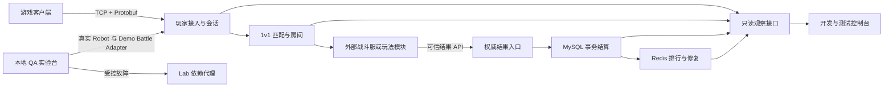
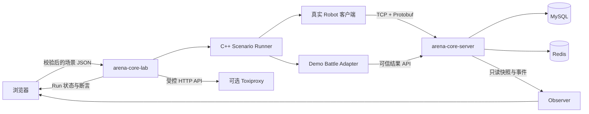
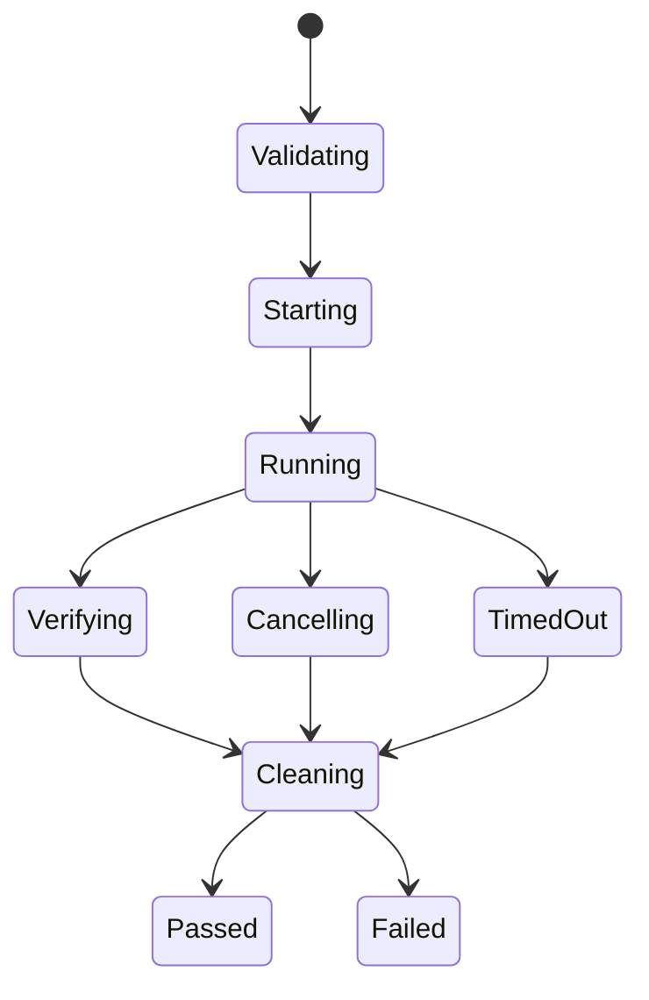

# 竞域 v1.1 产品设计提案

- 状态：产品方向已确认，按 M9—M12 分阶段实施
- 日期：2026-08-12
- 分支：`codex/v1.1-scenario-lab`
- 前置版本：`v1.0.1`
- 参考调研：`docs/research/github-game-server-reference-review-2026-08-12.md`
- 实施约束：只在 `codex/v1.1-scenario-lab` 实施；未经用户最终验收不合并 `main`、不上传 GitHub

## 1. 最终推荐定位

### 项目名称

> **竞域｜C++17 1v1 竞技游戏对局编排与结算服务**

### 一句话说明

> 竞域是一套可独立运行、可被游戏客户端和可信比赛服务接入的 C++17 后台，负责玩家会话、1v1 匹配、房间准备、权威结果接收、事务结算、排行榜与故障恢复，并提供真实协议驱动的本地 QA 实验台。

### 它在一款游戏中的位置

竞域解决的是一场比赛的“开始前、结束时和结束后”：让玩家连进来、匹配到对手、进入房间、接收可信胜负、可靠结算并更新排行榜。它不实现游戏画面、移动、技能、地图、命中判定或战斗同步。

## 2. 为什么要这样重新定位

v1.0.1 已经具备后台核心链路，但外部观看者很难区分“真实服务能力”和“教学演示数据”，第三方开发者也缺少一个正式的权威比赛结果接入入口。因此 v1.1 不是重写后台，而是完成两件决定项目能否成立的事：

1. **可接入**：普通客户端能使用玩家协议，可信战斗模块能提交权威结果。
2. **可验证**：任何在本机启动 Lab 的人都能修改安全参数，运行真实场景并看到证据。

这使项目从“有后端代码和固定演示按钮”变成“职责完整、可以接入、可以测试的服务端参考实现”。

## 3. 目标使用者

| 使用者 | 实际使用什么 | 不会接触什么 |
|---|---|---|
| 游戏客户端开发者 | Protobuf 玩家协议、示例客户端、连接/匹配/房间/排行接口 | 数据库、内部线程、结算写入口 |
| 战斗服或玩法模块开发者 | 受信任结果 API、幂等键、结果校验和错误目录 | 玩家 Session 和 Lab 控制接口 |
| QA / 技术评审者 | 本地场景实验台、Run 时间线、断言、重放和 JSON 报告 | 任意 SQL、Shell、Lua 或业务内存热改 |
| 服务维护者 | 只读状态、日志、健康状态、结算与缓存修复证据 | 测试故障开关，除非启动专用 Lab profile |
| 普通玩家 | 通过真正的游戏客户端间接使用服务 | Web 开发控制台 |

## 4. v1.1 主要目标

### G1：形成可以接入的真实对局闭环

玩家通过现有 TCP/Protobuf 完成连接、排队、匹配、入房和准备；可信战斗模块通过独立结果入口提交胜负；服务端完成 MySQL 事务结算和 Redis 排行更新。

### G2：清楚隔离权限边界

普通玩家不能提交胜负；只读观察 API 不能修改状态；Lab 只能在本机专用 profile 中运行；可信结果入口与玩家入口使用不同监听器和凭证。

### G3：让测试条件可修改、过程可见、结果可复现

本机使用者可以修改玩家数量、MMR、时序、断线、重复请求和依赖故障等受支持条件。每次运行生成不可变参数、随机种子、事件时间线、自动断言和唯一 `run_id`。

### G4：保留并强化 C++ 服务端技术证据

继续使用 C++17、Boost.Asio/Beast、strand、Protobuf、MySQL、Redis、Lua、CMake、双编译器、Sanitizer 和真实 Robot，不以框架替换现有核心实现。

### G5：让非作者也能快速判断项目做到了什么

全新使用者应能在 10 分钟内按文档启动本地环境，在 90 秒内运行一条完整对局，并从页面上看懂每一步的输入、真实事件、结算结果和恢复行为。

## 5. 产品功能边界

### 5.1 玩家接入面

- TCP 长连接与 Protobuf Envelope。
- Hello、心跳、超时、优雅关闭和 15 秒断线恢复。
- 请求幂等与稳定错误码。
- 进入/取消 1v1 匹配队列。
- MatchFound、加入凭证、Room Join、Ready 和 Leave。
- 查询个人排名和排行榜。

本部分以 v1.0.1 已有能力为主，v1.1 只补接入示例、错误说明和必要的观测字段，不重写网络主线。

### 5.2 可信比赛结果入口

v1.1 新增独立的内部 HTTP/JSON 入口，供同机或私有网络中的战斗服/玩法适配器提交结果。

双方 Ready 后，Room 不再立即调用进程内的确定性结果源，而是进入 `AwaitingResult`。v1.0.1 的确定性胜负逻辑迁出正式 Room 流程，改由独立 `Demo Battle Adapter` 在本地演示中模拟战斗服，并通过与真实接入方相同的结果 API 提交。这样页面看到的完整比赛不会绕过产品边界。

最小请求包含：

- `result_id`：调用方生成的全局幂等键。
- `match_id` / `room_id`：必须对应已存在且可结算的房间。
- 双方玩家及胜负结果：必须与房间成员完全一致。
- `rule_version`：指定服务端已加载的 Lua 积分规则版本。
- `finished_at`：可信比赛完成时间。

服务端必须保证：

- 普通玩家协议没有“宣布自己获胜”的消息。
- 同一 `result_id` 和相同指纹重复提交，返回原结算结果，不重复加分。
- 同一 `result_id` 但内容不同，返回幂等冲突。
- 同一比赛被不同结果重复结算，返回比赛已结算冲突。
- 房间成员、状态或规则版本不合法时，不写入任何部分数据。
- 接口默认关闭；启用时要求服务凭证，并限制在 loopback 或 Compose 私有网络。
- 超过配置的结果等待时限仍没有可信结果时，房间以“无结算结束”关闭，不改变任何玩家积分；迟到结果被稳定拒绝。

本地演示使用 `Demo Battle Adapter` 调用同一个结果入口，因此演示不会绕过真实结算边界。

结算事务提交成功后，在线参与者收到服务端生成的 `MatchResultCommitted` 通知，内容包括比赛、胜负、积分前后值、规则版本和 settlement ID。断线玩家恢复后可以使用只读 `GetMatchResult(match_id)` 查询自己的已提交结果。普通客户端只能接收或查询结果，仍不能写入结果。

### 5.3 结算、排行与恢复

- MySQL 是权威事实源，在单个事务中保存比赛、结果、双方积分变化和待修复标记。
- Lua 根据输入事实和版本化规则计算积分变化，不承担网络或存储职责。
- Redis 提供排行榜快速读取。
- Redis 写入失败不回滚已成功的比赛事实；dirty repair 在依赖恢复后补齐缓存。
- 页面分别显示“事实已保存”“缓存暂时落后”“缓存已恢复”，不把三者混成一个成功标签。

### 5.4 开发与测试控制台

Web 不再表现为游戏画面，也不再用三个固定教学按钮代表产品。它明确分成四个页面：

1. **服务概览**：只读显示连接、队列、房间、结算、排行缓存和健康状态。
2. **场景实验台**：选择场景、修改安全参数、预览预期、启动或取消 Run。
3. **运行详情**：显示输入快照、真实事件时间线、当前对象、自动断言、失败步骤和清理状态。
4. **接入指南**：说明游戏客户端和可信战斗模块分别怎样接入。

页面首页必须先回答：这是哪个后台服务、谁会使用它、现在能真实运行什么、结果在哪里看。

### 5.5 可参数化 QA 实验台

推荐新增 `arena-core-lab`，它是独立 C++17 本地程序，不进入正式服务进程。

Controller 直接复用 C++ QA 场景库，不允许浏览器传入可执行命令，也不通过 Shell 启动任意进程。

## 6. v1.1 场景目录

### P0：版本必须完成

| 场景 | 用户可修改的条件 | 主要断言 |
|---|---|---|
| 完整对局 | 偶数玩家 2–32、MMR 模式、连接/Ready 间隔、种子 | 全部连接、正确配对、每房间只结算一次、排行变化正确 |
| 断线恢复 | 玩家、断线阶段、重连延迟 | 窗口内恢复同一身份；过期后稳定失败；旧连接不能覆盖新连接 |
| 重复玩家请求 | 消息类型、重复次数 1–10 | 相同请求返回一致结果，不重复推进状态 |
| 重复权威结果 | 相同或冲突指纹、重复次数 | 相同结果幂等；冲突结果被拒绝；积分只变化一次 |
| Redis 故障恢复 | 故障时机、持续时间、延迟/断开类型 | MySQL 事实完成、dirty 可见、Redis 恢复后排行补齐 |

### P1：v1.2 候选，不进入本次实现

| 场景 | 价值 |
|---|---|
| MySQL 延迟/断开 | 验证事务失败、Room 保持可重试和无半结算 |
| 非法帧/非法状态 | 验证协议边界、错误码和连接关闭策略 |
| 100/500 连接压力预设 | 复用既有 Robot，按场景、阶段和阈值输出结果 |
| Run 对比 | 比较两次参数或版本的通过率、P95/P99、错误与恢复时间 |

这些能力有价值，但不是证明 v1.1“可接入、可验证”所必需的条件。v1.1 继续保留现有命令行压力、非法协议和 MySQL 故障自动测试，不把它们全部包装进页面，也不因 P1 延迟发布。

### P2：未来版本候选

- 2v2/组队匹配和多种 MatchProfile。
- 独立战斗服分配与回填。
- 远程多人控制台、账号、RBAC 与完整审计。
- 多实例、高可用、Kubernetes 和跨区部署。

P2 不属于 v1.1，不能在实现时顺手加入。

## 7. 场景输入规则

安全输入采用版本化 JSON Schema，每个字段都有类型、范围、组合约束和默认值。页面不接受任意 SQL、Shell、Lua、文件路径、宿主机地址或 Protobuf 原始字节。

首批公共参数：

| 参数 | 范围 |
|---|---|
| 玩家数量 | 偶数 2–32；压力预设使用独立入口 |
| MMR | 0–10000；统一、阶梯、随机或逐人设置 |
| 随机种子 | 固定无符号整数或自动生成后落盘 |
| 连接间隔 | 0–5000 ms |
| Ready 延迟 | 0–5000 ms |
| 断线阶段 | 不断线、排队前、匹配后、入房后 |
| 重连延迟 | 0–25000 ms，用于覆盖窗口内外 |
| 重复次数 | 1–10 |
| 依赖故障 | 无、延迟、超时、断开、连接重置 |
| 故障持续 | 1–30 秒 |
| Run 超时 | 按场景给定有限上限，不允许无限运行 |

## 8. Run 模型

每次点击运行都会创建一个真实的 `Run`：

- 唯一 `run_id`。
- 场景类型和 Schema 版本。
- 不可变参数快照与随机种子。
- Git commit、构建版本、服务配置摘要。
- 开始/结束时间和有限状态。
- 单调递增的事件序号与 trace 关联。
- 预期断言、实际值和第一个偏离步骤。
- 取消、超时、故障复原和 Robot 清理证据。

状态机：

默认只允许一个交互 Run 运行，避免场景互相污染。结束后保存 JSON 报告；“重放”创建新的 `run_id`，但复用原始参数和种子。

## 9. 技术架构调整

### 9.1 保留的主技术栈

- C++17，不升级 C++20/23。
- Boost.Asio callback + strand，不改成协程主线。
- Boost.Beast 提供内部 HTTP、只读 Observer 和 Lab Controller。
- Protobuf 保持玩家实时协议。
- nlohmann/json 用于内部结果 API、场景配置和 Run 报告。
- MySQL Connector/C++、hiredis、Lua C API 保持不变。
- CMake、GCC 13、Clang 18、GTest/CTest、ASan/UBSan/TSan 保持不变。
- 原生 HTML/CSS/JavaScript，不增加 Node 或大型前端框架。

### 9.2 推荐模块

| 模块/程序 | 职责 |
|---|---|
| `arena-core-server` | 玩家 TCP、Match/Room、可信结果入口、结算、排行和只读观察 |
| `arena-core-robot` | 命令行真实协议客户端，适合 CI、手工复现和压力预设 |
| `arena-core-lab` | loopback 本地控制器、Run 生命周期、参数校验、场景编排和报告 |
| `arena_core_qa` | Robot 和 Lab 共用的 C++ 场景库，不包含网页或任意命令执行 |
| `DemoBattleAdapter` | 通过可信结果 API 结束本地示例对局，模拟未来战斗服职责 |
| Toxiproxy lab profile | 可选依赖故障代理，不进入默认或正式运行路径 |

### 9.3 四条网络边界

| 边界 | 权限 | 默认可达范围 |
|---|---|---|
| 玩家 TCP | 普通游戏客户端 | 配置决定，可对局域网开放 |
| 可信结果 API | 战斗服/适配器服务凭证 | loopback 或 Compose 私有网络 |
| Observer HTTP | 只读 | loopback |
| Lab Controller HTTP | 启动/取消测试、受控故障 | 仅 loopback，正式 profile 不启动 |

## 10. API 设计基线

### 10.1 可信结果 API

- `POST /internal/v1/match-results`
- `GET /internal/v1/match-results/{result_id}`：只读查询幂等结果
- Bearer service token；非 loopback 部署必须由私有网络或 TLS 反向代理保护
- 返回稳定业务码：accepted、idempotent_replay、result_conflict、match_not_found、room_not_settleable、roster_mismatch、rule_version_unknown、storage_unavailable

### 10.2 玩家结果读取

- 新增 `MatchResultCommitted` 服务端通知，只能由已提交的结算事实生成。
- 新增 `GetMatchResult` 请求/响应，仅允许比赛参与者查询。
- 重复通知或重复查询不改变任何状态。
- 在 MySQL 事务提交前不得向玩家声称结算成功；Redis 暂时落后时通知中明确标记排行榜待刷新。

### 10.3 Lab API

- `GET /api/lab/v1/capabilities`
- `GET /api/lab/v1/scenarios/{name}/schema`
- `POST /api/lab/v1/runs`
- `GET /api/lab/v1/runs/{run_id}`
- `GET /api/lab/v1/runs/{run_id}/events?after_seq=`
- `POST /api/lab/v1/runs/{run_id}/cancel`
- `POST /api/lab/v1/runs/{run_id}/replay`

v1.1 继续使用短轮询读取 Run 事件，不为了页面效果引入 WebSocket；若后续证明轮询成为瓶颈，再单独评估 SSE。

## 11. 非功能要求

### 安全

- 正式 profile 不启动 Lab Controller 和 Toxiproxy。
- Observer 继续只读；不得增加直接改 Session/Room/分数的接口。
- 可信结果入口默认关闭并使用单独凭证。
- 不记录明文 token；日志中的凭证和连接信息必须脱敏。

### 可靠性

- Run 无论通过、失败、取消还是超时，都必须恢复依赖代理并停止临时客户端。
- 服务端重启后结算幂等事实仍然有效。
- Redis 故障不丢 MySQL 事实；MySQL 失败不得产生半结算。

### 性能

- 不低于 v1.0.1 已验证的 500 连接、250 房间、600 秒稳定性基线。
- Lab 的页面刷新和事件记录不得进入玩家网络 strand 的阻塞路径。
- 压力预设与交互场景分开，页面必须提示资源影响。

### 可维护性

- 每个 P0 场景有单元/组件/真实依赖/E2E 中至少两层验证。
- Scenario Schema、结果 API 和错误目录需要版本化。
- 新模块同时通过 GCC、Clang、CTest 和相关 Sanitizer。

## 12. 验收标准

v1.1 只有同时满足下列条件才算完成：

1. 新用户按 README 在干净环境启动默认服务和可选 Lab profile。
2. 示例客户端通过真实 TCP/Protobuf 完成连接到 Ready。
3. Room 在 Ready 后进入 `AwaitingResult`；Demo Battle Adapter 通过可信结果 API 提交结果；玩家收到已提交结果通知，普通客户端提交胜负会被协议边界阻止。
4. 完整对局、断线恢复、重复请求、重复结果、Redis 故障五个 P0 场景都可修改参数并运行。
5. 每个 Run 都能查看输入、过程、断言、结算证据和清理结果，并能用原参数重放。
6. Redis 故障场景真实经过代理，页面能依次看到 MySQL 成功、缓存落后和自动恢复。
7. 默认服务不暴露 Lab 能力；Observer 仍然只读。
8. GCC/Clang 回归、真实 MySQL/Redis、浏览器 E2E、Sanitizer 和稳定性门禁通过。
9. 保留 `main`、`v1.0.0` 和 `v1.0.1`；只有用户人工确认后才考虑合并实验分支。
10. GitHub 公开发布仍需用户单独授权。

## 13. 实施阶段

### M9：接入边界

- 冻结结果模型、错误码和权限边界。
- 实现可信结果 API 与 Demo Battle Adapter。
- 将确定性结果生成移出 Room，增加 `AwaitingResult`、结果等待超时、玩家结果通知与查询。
- 补最小客户端和战斗模块接入示例。
- 验证权限隔离、幂等、冲突和事务失败。

### M10：Run 与场景引擎

- 抽取可复用 `arena_core_qa` 场景库。
- 实现 Scenario Schema、Run 状态机、取消/超时/清理和 JSON 报告。
- 实现前四个无依赖代理的 P0 场景。

### M11：本地实验台与真实故障

- 实现 `arena-core-lab` 和四页开发控制台。
- 接入 Toxiproxy lab profile 和 Redis 故障场景。
- 实现时间线、断言、重放和失败定位。

### M12：质量与交付

- 完成双编译器、真实依赖、浏览器 E2E 和 Sanitizer 回归，不顺手实施 P1 候选功能。
- 复验 500/250/600 秒基线与 fresh-clone。
- 更新 README、架构、协议、接入、测试、运维和非技术演示说明。
- 用户只在最终可见效果与是否合并分支两个节点介入。

## 14. 本次明确不做

- 不做可玩的游戏客户端或网页游戏。
- 不做帧同步、状态同步、战斗服、技能、地图或反作弊。
- 不做账号、社交、聊天、商城、锦标赛和推送平台。
- 不做通用 MMO 框架、微服务拆分、Kubernetes 或公有云部署。
- 不把页面变成任意后台修改工具。
- 不升级 C++ 标准、不替换 Boost.Asio、不引入大型前端框架。
- 不自动合并 `main` 或公开 GitHub。

## 15. 产品方向确认记录

用户已在 2026-08-12 确认以下产品方向：

> 是否同意把竞域 v1.1 做成“可被游戏客户端和可信比赛模块接入的 1v1 对局编排与结算服务”，并把 Web 明确定义为开发/QA 控制台，而不是游戏画面。

本文件现为 v1.1 范围基线。M9 已实现可信结果接入；实现过程中只有范围变化、权限/环境阻塞、最终可见效果和分支合并需要用户介入。
